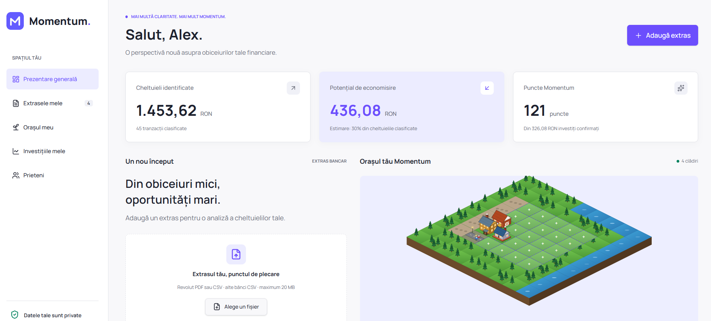
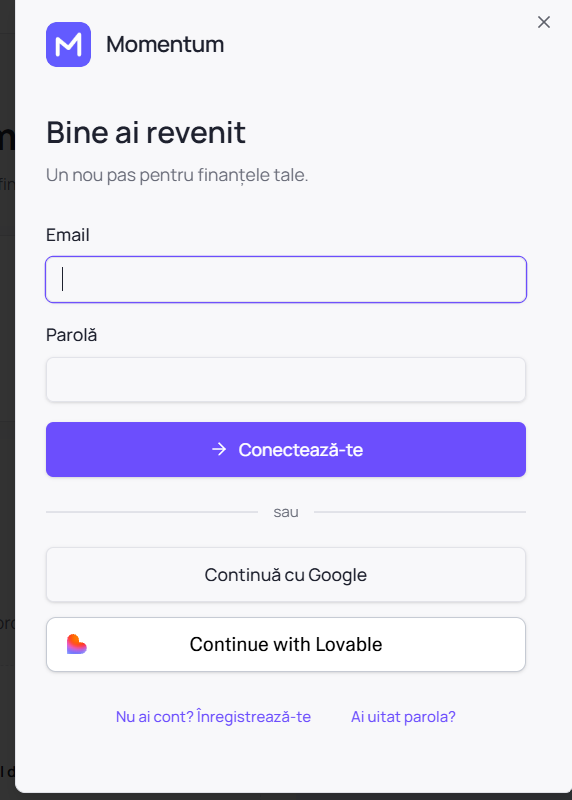
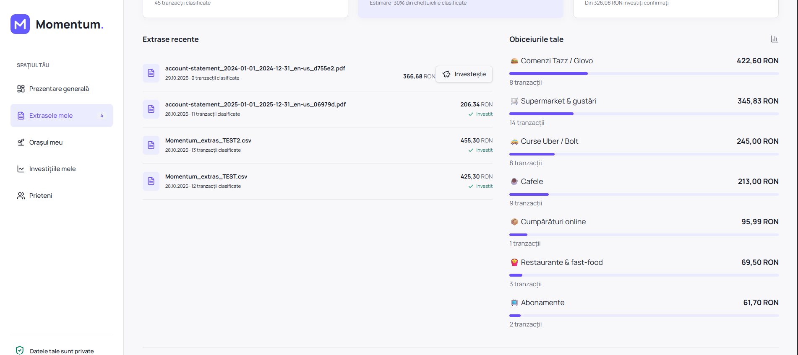
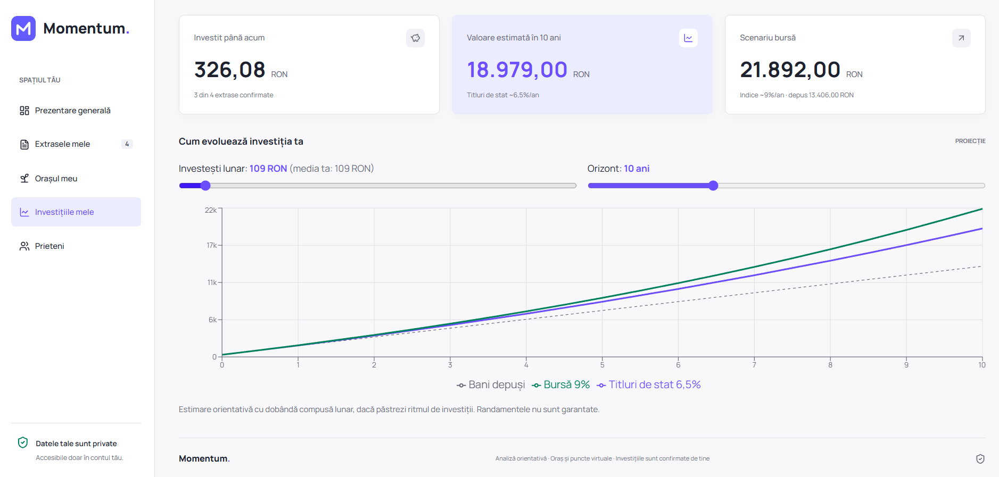
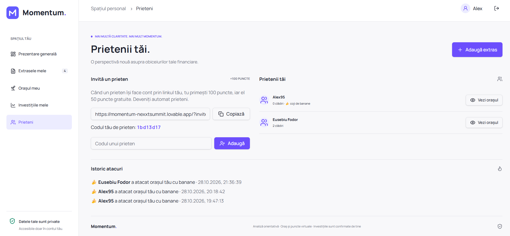

# 🏝️ Momentum
> **Stripe Hackathon Challenge: Rethinking Financial Futures**  
> *Transformarea micilor impulsuri zilnice în securitate financiară pe termen lung prin gamificare comportamentală.*

🔗 **Live Demo Application:** [https://momentum-nexxtsummit.lovable.app](https://momentum-nexxtsummit.lovable.app)

---

## 📸 Prezentare Vizuală Aplicație

<div align="center">
  
  <p><em>Panoul central Momentum: evaluarea cheltuielilor, încărcarea extrasului și regatul izometric evolutiv.</em></p>
</div>

<br/>

| Autentificare & Securitate | Analiză & Obiceiuri Identificate |
| :---: | :---: |
|  |  |
| *Flux de acces facil (Open Banking / Social Auth)* | *Detecția automată a categoriilor de consum (Tazz, Bolt, Cafele)* |

| Proiecție Financiară (Dobândă Compusă) | Dimensiune Socială & Co-op |
| :---: | :---: |
|  |  |
| *Simularea randamentului pe termen lung (Titluri de stat / Bursă)* | *Mecanici sociale de retenție, interacțiune și atacuri amicale* |

---

## 📌 Executive Summary
Majoritatea tinerilor din România resimt anxietate și paralizie decizională când vine vorba de investiții sau pensie. Deși adopția plăților digitale și a serviciilor de livrare/ride-sharing este la un nivel record, participarea la instrumente financiare sigure rămâne printre cele mai scăzute din Europa.

**Momentum** rezolvă această problemă printr-o abordare de **Behavioral Wealth**: 
În loc să ceară utilizatorului un efort de economisire rigid, aplicația analizează tranzacțiile din extrasele de cont bancar, identifică cheltuielile repetitive („plăcerile vinovate” precum cafelele sau comenzile de mâncare) și propune un compromis blând. Reducerea parțială a acestor obiceiuri eliberează fonduri direcționate automat spre instrumente cu randament stabil (ex: Titluri de Stat Tezaur/Fidelis sau indici bursieri), recompensând progresul cu tokeni pentru construirea unui regat izometric interactiv.

---

## 🎯 Ce rezolvă Momentum

### 1. Who it serves & The Problem
* **Public țintă:** Generația Z și tinerii profesioniști din România aflați la început de carieră.
* **Problema:** Reticența față de limbajul bancar tehnic, lipsa educației financiare aplicate și tendința de consum impulsiv pe platforme de delivery și ride-sharing.
* **Soluția:** Un strat de gamificare accesibil care face din economisire un obicei recurent și tangibil vizual.

### 2. End-to-End User Experience
1. **Analiza Extrasului de Cont:** Utilizatorul încarcă un fișier PDF/CSV cu tranzacțiile bancare (sau folosește butonul *Încarcă Extras Demo*). Algoritmul identifică tiparele recurente de consum (Starbucks, 5 to go, Tazz, Glovo, Bolt, Uber).
2. **Recomandarea Inteligentă:** Sistemul calculează impactul unei reduceri de doar 25-30% din aceste cheltuieli și prezintă proiecția acumulării prin dobânda compusă pe 10–30 de ani.
3. **Simularea Micro-Investiției:** Cu un singur click, diferența economisită este alocată virtual în instrumente garantate, iar utilizatorul primește tokeni de construcție.
4. **Dezvoltarea Orașului Izometric:** Tokenii sunt folosiți pentru plasarea și evoluția clădirilor pe o hartă 3D izometrică (case, cafenele, infrastructură).
5. **Loss Aversion (Aversiunea la Pierdere):** Retragerea prematură a banilor din fond declanșează degradarea vizuală a orașului, descurajând deciziile impulsive de cheltuire a economiilor.

### 3. De ce este relevant în România
* România prezintă un contrast puternic: un consum ridicat în comerțul electronic și livrări rapide, combinat cu o pondere foarte redusă a populației active care investește.
* Momentum nu propune instrumente speculative volatile, ci leagă stilul de viață cotidian de mecanisme locale sigure: **Titlurile de Stat Fidelis/Tezaur** (nepozitabile) și fondurile diversificate.

### 4. Arhitectură, Ipoteze și Conformitate Legală
* **Arhitectură de tip Pass-Through:** Aplicația acționează exclusiv ca un motor comportamental (Behavioral Layer) peste infrastructura bancară. În scenariul de producție complet, transferurile sunt intermediate direct de Stripe și protocoalele Open Banking (PSD2).
* **Fără Risc Custodial:** Momentum nu colectează și nu reține fondurile utilizatorilor în conturi proprii, eliminând necesitatea autorizării ca fond de investiții sau instituție de credit de către ASF/BNR.
* **Model de Monetizare Sustenabil:** Parteneriate B2B / Lead Generation cu băncile partenere (comision la deschiderea de produse de economisire) și model B2C Freemium pentru personalizări vizuale avansate în joc.

---

## 🛠️ Stack Tehnic & Componente
* **Frontend:** React, TypeScript, Tailwind CSS, Lucide Icons, Framer Motion.
* **Map Engine:** Grid izometric interactiv stilizat cu clădiri vectoriale SVG adaptabile la stări de degradare și upgrade.
* **Parsing Engine:** Parsare automată client-side a fișierelor bancare structurate (inclusiv simulator de flux demonstrativ).
* **Persistență:** LocalStorage State Engine pentru păstrarea layout-ului orașului, a tranzacțiilor și a tokenilor între sesiuni.

---

## 🚀 Rulare Locală

Pentru a rula proiectul pe propriul computer:

```bash
# 1. Clonare repository
git clone [https://github.com/USERNAME/NUME-REPO.git](https://github.com/USERNAME/NUME-REPO.git)
cd NUME-REPO

# 2. Instalare dependențe
bun install
# sau
npm install

# 3. Pornire server de dezvoltare
bun dev
# sau
npm run dev
